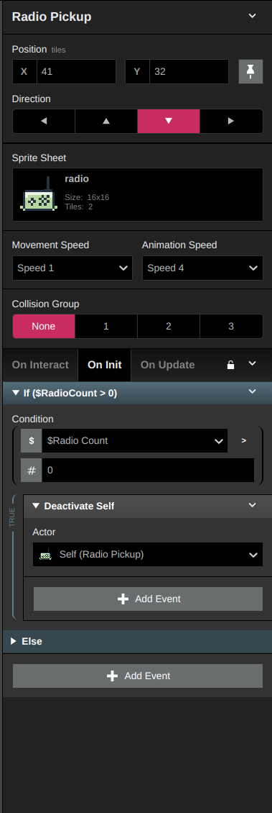
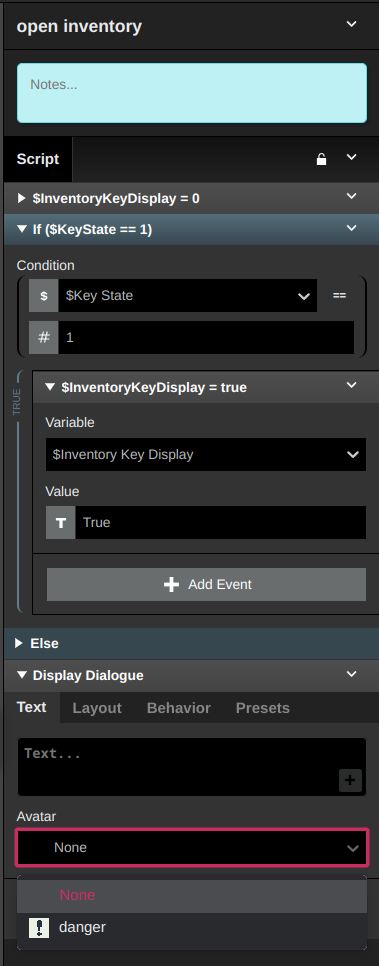

You are assisting me in developing a Game Boy game with GB Studio 4.3.2.

## How we work
- You act as an advisor. I implement everything myself in the GB Studio editor.
- You cannot see or edit any project files, and I will not share project files or their contents.
- Give numbered step-by-step instructions for the editor: which view to open, which element to select, which event to add, and which values to set. Use the exact names of menus, events and fields as they appear in GB Studio 4.3.2.
- If GBVM code is needed, provide a complete snippet that I can paste unchanged into a "GBVM Script" event.
- I will follow your instructions literally and report what happens, including build output and screenshots of the editor or the running game.
- If information is missing, ask me. If something is not specified, decide yourself and state your decision.

## Global specification
- A "field" is 16x16 px (2x2 tiles), the size of the player sprite.
- Distances are measured in fields as Chebyshev distance: max(|x1 - x2|, |y1 - y2|).
- One second has 60 frames.
- Controls: D-pad = move, A = interact, B = open/close inventory. Start and Select are unused.
- Interaction: the player must be at most 1 field away from the object and face it.
- Returning to the title screen resets all variables and object states to their initial values. Scene changes do not reset states or variables.

## Quality requirements
- The game must build without errors or engine warnings and stay within Game Boy hardware limits.
- Use descriptive names for scenes, actors, triggers and variables. Reuse logic where it is required. Do not change anything the task does not require.

## Current project state
The game is still mostly GB Studio's stock top-down sample project. It has eight TOPDOWN scenes: Logo and Title Screen (UI), the 56-tile-wide Sample Town, two interiors (Music House and Top House), two cave scenes (Cave and Underground) and one teleporter room (which is reachable via an invisible trigger). These are connected by triggers, with 18 in Sample Town alone. The actors are the sample's own and some additional actors:
- Sample Town: an angry guy, a florist, a cat, a duck, a pet owner, a rock, a sign post, a (initially closed) chest which can be opened and yields one coin, and two other coins which can be collected by walking over them, a (initially closed) door with a switch next to it, which unlocks the door after interaction; another (initially closed) door which can be unlock by interacting with it after a key has been collected (variable Key State = 0 = door closed, key not yet collected; Key State = 1 = key collected, door can be opened; Key State = 2 = door unlocked, key permanently consumed).
- Music House: a DJ with a drumkit, a keyboard and machines.
- Top House: a radio and the radio guy.
- Caves: a sage, fires, a save point (also stored as the one actor prefab), plus pushable rocks, an ice block and hidden stairs in the Underground.

There's one shared script, "Init Menu", which the scenes call. The variables are mostly the sample's defaults: Quest1–12, Health, Defeated, Turnip Counter, Seen Cat/Duck, Used Radio, Pushed Ice Block, tile and menu/save helpers, and so on. The asset library is the standard bundle: about 40 sprites (NPCs, player variants, chest, portal, switch-like props, enemies and more), around 20 backgrounds, Rulz/Tronimal music tracks, emotes, two fonts and two animated tilesets. The project has no sound-effect assets at the moment.
- Implemented in previous tasks: Chest actor that can be opened and displays a text when opened (and retains an "opened" state); NPC that displays a dialogue when talked to; modification to the chest actor so that the player receives a coin when opening the chest for the first time; two other coin actors were added where walking over them triggers the collect coin script (the collect coin script increments the variable CoinCounter); Enemy that patrols normally and starts chasing the player once he gets too close, goes back to patrolling if player is far enough away (this is done by events in the OnInit and OnUpdate tabs of the enemy actor); 

## Task A6: Simple inventory system
A simple inventory system in which the player can view collected items. 
The player can collect different item types (coins, a key and a radio, all of which have their respective sprites) that are placed somewhere in the game world. 
Collected items are stored in the inventory, which can be opened and closed with a defined button, and are displayed with their icon and the collected quantity. 
Item counts are kept after a scene change.

## Regression task: 
Also show the collectible coins from A3 and the collectible key from the optional task in A5 in the inventory.

## Acceptance criteria
A6.1: At least 3 different item types are placed at fixed positions in the game world; at least one type exists 2 or more times.
A6.2: Collecting an item makes it disappear and increases the count of exactly this type by 1. Initial counts are 0.
A6.3: The inventory opens and closes with the B button.
A6.4: It shows the icon and the count for each type.
A6.5: While the inventory is open, the game is paused and the player does not move. After closing, everything continues as before.
A6.6: The inventory cannot be opened during a dialogue.
A6.7: Counts are kept after a scene change.

## Regression task
A6R.1: Coins from A3 and the key from A5 appear in the inventory with icon and count.
A6R.2: The inventory display and the counter or key status always match (one data source, no double bookkeeping).
A6R.3: The behavior of coins, chest, key and door remains unchanged.

# LLM Answer

Note: "GB Studio 22.3.27" doesn't exist. All names below are for **GB Studio 4.3.2**.

## My design decisions

- **One data source per item:**
  - Coins: the existing `CoinCounter`.
  - Key: the existing `Key State`. The displayed count is 1 when `Key State = 1`, otherwise 0. After the door is unlocked the key is used up, so it shows 0.
  - Radio: a new variable `Radio Count`, plus one new walk-over pickup in Sample Town. The existing radio prop in Top House stays unchanged.
- **Display:** a dialogue window (overlay) opened through GBVM. It is *modal*, so the engine pauses completely: actors, the enemy's On Update, and the player. It closes **only with B**.
- **Icons:** 8×8 versions of the item sprites, drawn into three unused characters `{ | }` of the default font. A font has no other way to show images inside text.
- **A6.6** is covered automatically. During a modal dialogue no button scripts run, and B only advances the text.

## 1. Variables
1. Open the **Variables** view.
2. Rename two unused variables to `Radio Count` and `Inventory Key Display`.

## 2. Icons in the font
1. Open **Settings** and note the **Default Font**.
2. Open its PNG in `assets/fonts/` in an image editor. The grid is 8×8 cells, 16 per row, starting with the space character.
3. Overwrite these cells, using the same colors as the existing glyphs:
   - `{` (x=88, y=40): coin icon
   - `|` (x=96, y=40): key icon
   - `}` (x=104, y=40): radio icon
4. Save the file. GB Studio reloads it automatically.

## 3. Radio pickup (Sample Town)
1. **World** view → Sample Town → **Add Actor** at a free spot. Name it `Radio Pickup` and set the sprite to the radio sprite.
2. **On Init** tab:
   - **If Variable Compare With Value**: `Radio Count` `>` `0`
   - → True: **Deactivate Actor**: `Self`
3. **On Hit** tab → **Player**:
   - **Variable Increment By 1**: `Radio Count`
   - **Deactivate Actor**: `Self`

## 4. Script "Open Inventory"
1. **Scripts** in the sidebar → **+** → name it `Open Inventory`.
2. Add these events:
   1. **Variable Set To Value**: `Inventory Key Display` = `0`
   2. **If Variable Compare With Value**: `Key State` `==` `1`
      → True: **Variable Set To Value**: `Inventory Key Display` = `1`
   3. **GBVM Script** with this code:

```
VM_LOAD_TEXT 3
    .dw VAR_COINCOUNTER, VAR_INVENTORY_KEY_DISPLAY, VAR_RADIO_COUNT
    .asciz "Inventory\012\012{ Coins  %d\012| Key    %d\012} Radio  %d\012\012B: close"
VM_OVERLAY_CLEAR 0, 0, 20, 9, .UI_COLOR_WHITE, ^/(.UI_AUTO_SCROLL | .UI_DRAW_FRAME)/
VM_OVERLAY_MOVE_TO 0, 9, .OVERLAY_IN_SPEED
VM_DISPLAY_TEXT
VM_OVERLAY_WAIT .UI_MODAL, ^/(.UI_WAIT_WINDOW | .UI_WAIT_TEXT)/
VM_OVERLAY_WAIT .UI_MODAL, .UI_WAIT_BTN_B
VM_OVERLAY_MOVE_TO 0, 18, .OVERLAY_OUT_SPEED
VM_OVERLAY_WAIT .UI_MODAL, .UI_WAIT_WINDOW
```

If the build reports an unknown `VAR_...` symbol, send me the error line. The symbol names come from the variable names.

## 5. Bind the B button (reused in all scenes)
1. Create a new script `Inventory Button Setup`.
2. Add **Attach Script To Button**: Button `B`. Inside it, add **Call Script**: `Open Inventory`.
3. In the **On Init** of Sample Town, Music House, Top House, Cave, Underground and the teleporter room, add **Call Script**: `Inventory Button Setup` at the end.
   - Don't add it to Logo or Title Screen.
   - It has to go in every scene because button bindings are cleared on every scene change.

## 6. Tests
1. Open the inventory before collecting anything: all counts are 0.
2. Coins: open the chest, then collect both walk-over coins. Coins should show 1, 2, 3, and the chest text and chest state behave as before.
3. Key: collect the key → Key shows 1. Open the door → Key shows 0, and the door stays open.
4. Radio: walk over it → it disappears and Radio shows 1. Leave the scene and come back → it stays gone and still shows 1.
5. While the enemy is chasing you, press B. Everything should freeze, and arrow keys and A do nothing. Press B again → everything continues from the same place.
6. Talk to an NPC and press B during the dialogue. The inventory must not open, including between two dialogue pages.
7. Return to the title screen → all counts are back to 0.

Report the build output and your results for tests 5 and 6.


8min

# 2nd interation

I cannot carry out step 2. Solve the task without me needing to modify png assets. The task should be solvable using the GB Studio Editor exclusively

# LLM Answer

Without editing PNGs, the only editor-only way to show an item sprite inside a paused window is the **avatar** of a "Display Dialogue". Each dialogue box can hold only one avatar, so the inventory becomes **three pages, one per item**. Each page shows the item's icon and count.

Everything else from my previous answer stays the same. Steps 1 (variables), 3 (radio pickup) and 5 (B button binding) are unchanged. Step 2 is dropped. Step 4 is replaced by the steps below.

## New step 4: Script "Open Inventory"
1. **Scripts** in the sidebar → open `Open Inventory`. If you already added the GBVM Script event, delete it.
2. Keep these first two events:
   1. **Variable Set To Value**: `Inventory Key Display` = `0`
   2. **If Variable Compare With Value**: `Key State` `==` `1`
      → True: **Variable Set To Value**: `Inventory Key Display` = `1`
3. Add **Display Dialogue** (coin page):
   - **Avatar**: the coin sprite
   - **Text**: `Inventory 1/3` (new line) `Coins: $CoinCounter$`. To insert the variable, type `$` and pick it from the list.
   - Open the event's advanced options (cog icon) and set **Close Button** to `B`.
4. Add **Display Dialogue** (key page):
   - **Avatar**: the key sprite
   - **Text**: `Inventory 2/3` (new line) `Key: $Inventory Key Display$`
   - **Close Button**: `B`
5. Add **Display Dialogue** (radio page):
   - **Avatar**: the radio sprite
   - **Text**: `Inventory 3/3` (new line) `Radio: $Radio Count$`
   - **Close Button**: `B`

## How the criteria are met
- **A6.4:** each item type has its own page with its sprite as the icon and its count.
- **A6.3:** B opens the inventory and moves through the pages. The third B press closes it.
- **A6.5:** Display Dialogue pauses the whole game while it is open. The three dialogues follow each other directly, so the game stays paused until the last page closes.
- **A6R.2:** each page reads straight from `CoinCounter`, `Key State` (through `Inventory Key Display`, recalculated every time the inventory opens) and `Radio Count`. There is no second counter to keep in sync.

## Changes to the tests
In tests 1–5 from my previous answer, check all three pages. In test 5, also check that **A does not move to the next page or close the inventory**.

If your Display Dialogue event has no **Close Button** field, A will also turn the pages. In that case, send me a screenshot of the event's advanced options.

# 3rd iteration

I cannot carry out step 3.3: <On Hit tab> does not exist in GB Studio 4.3.2. The attached screenshot shows what I see at this point.



# LLM Answer

The On Init setup in your screenshot is correct.

In GB Studio 4, the **On Hit** tab only appears when the actor belongs to a collision group. With **Collision Group = None**, the player's collision with the actor isn't reported, so the tab is hidden.

## Corrected step 3.3
1. Select **Radio Pickup**.
2. Under **Collision Group**, click **1**. This doesn't conflict with anything, because the radio is not an enemy or projectile.
3. A new **On Hit** tab now appears next to On Interact / On Init / On Update. Open it.
4. Inside On Hit, select the **Player** sub-tab and add:
   1. **Variable Increment By 1**: `Radio Count`
   2. **Deactivate Actor**: `Self (Radio Pickup)`

If **On Hit** still doesn't appear, send me a screenshot of the actor panel. Also tell me how your coins from A3 are collected: through the coin actor's On Hit tab, or through a trigger.

# 4th iteration

I cannot carry out step 4.3: The coin sprite is not an option for the avatar. The attached screenshot shows what I see at this point.



21min

# LLM Answer

The avatar list in GB Studio 4 doesn't show sprites. It only shows assets from the separate **Avatars** folder, and the only one there is "danger". New avatars would need PNG files, so this route is closed.

**New solution:** each gameplay scene gets one hidden **Inventory Icon** actor that is pinned to the screen. While a page is shown, this actor is switched to the coin, key or radio sprite and sits just above the dialogue box. A Display Dialogue still pauses the game, and the paging stays the same.

Your first two events in the screenshot are fine. Setting `Inventory Key Display` to **True** stores 1, so it works.

## A. Icon actor (Sample Town)
1. **World** view → Sample Town → **Add Actor**. Name it `Inventory Icon`.
2. **Sprite Sheet**: coin. **Collision Group**: None.
3. Click the **pin icon** next to Position, so it's pinned to the screen. Set **X = 9** and **Y = 12**. That puts it horizontally centered, just above the dialogue box.
4. **On Init** tab: add **Deactivate Actor** → `Self`.
5. Click ▼ at the top right of the actor panel → **Convert To Prefab**.
6. Add this prefab to Music House, Top House, Cave, Underground and the teleporter room. Each instance needs the same pinned position: X 9, Y 12.

## B. Rework the "Open Inventory" script
1. In the script panel, click ▼ next to "Script". If you see **Parameters**, add one parameter of type **Actor** and name it `Icon`. If not, the Actor fields will offer an actor parameter automatically (e.g. "Actor A"). Use that one.
2. Delete the empty Display Dialogue. After your If event, add these events:
   1. **Set Actor Sprite Sheet**: Actor `Icon`, sprite coin
   2. **Activate Actor**: `Icon`
   3. **Display Dialogue**: `Coins: $CoinCounter$`. In the **Behavior** tab, set the close button to **B** if that option exists.
   4. **Set Actor Sprite Sheet**: `Icon`, sprite key
   5. **Display Dialogue**: `Key: $Inventory Key Display$` (Behavior as above)
   6. **Set Actor Sprite Sheet**: `Icon`, sprite radio
   7. **Display Dialogue**: `Radio: $Radio Count$` (Behavior as above)
   8. **Deactivate Actor**: `Icon`

## C. Button binding per scene (replaces the old step 5)
1. Delete the custom script `Inventory Button Setup` and its **Call Script** events in the scenes. A script can't pass on each scene's own icon actor.
2. In the **On Init** of each of the 6 gameplay scenes, add at the end: **Attach Script To Button**, Button `B`. Inside it, add **Call Script** `Open Inventory`, with `Icon` set to that scene's **Inventory Icon**.

## Test
Press B and check that the icon appears just above the dialogue box and changes on each page. If it's in the wrong place or covered by the box, send me a screenshot. I'll adjust X/Y.

40min

